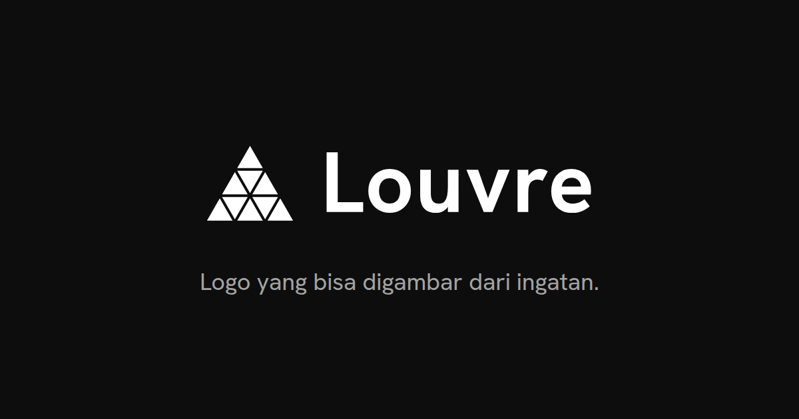

# Louvre — landing page



Landing page **https://louvre.my.id**: pintu masuk ke alat-alat yang saya (Bahar,
developer & sysadmin) bangun dan jalankan sendiri di satu server Linux, sekaligus
portofolio. Tersedia dalam dua bahasa (EN di `/`, ID di `/id/`) dengan tema terang dan gelap.

## Isi koleksi

| App | Alamat | Akses | Kode |
|---|---|---|---|
| **Pulse**: dasbor server pribadi (metrik, log, terminal, agen AI) | [pulse.louvre.my.id](https://pulse.louvre.my.id/) | khusus pemilik | privat |
| **Logo**: identitas visual Louvre dan pedoman pemakaiannya | [logo.louvre.my.id](https://logo.louvre.my.id/) | publik | [louvre-logo](https://github.com/bahawww/louvre-logo) |
| **Langit Jakarta**: kualitas udara (ISPU) Jakarta dan model ML | [udara.louvre.my.id](https://udara.louvre.my.id/) | publik | [langit-jakarta-ispu](https://github.com/bahawww/langit-jakarta-ispu) |

## Teknologi

- [Astro](https://astro.build/) 7, keluaran statis. Satu file CSS, tanpa framework JS di browser; skrip kecil ditulis inline.
- Font [Hanken Grotesk](https://fonts.google.com/specimen/Hanken+Grotesk), di-host sendiri.
- Disajikan oleh [Caddy](https://caddyserver.com/) di Docker, di belakang Cloudflare.

## Struktur

| Path | Isi |
|---|---|
| `src/data/apps.ts` | **Satu-satunya** daftar app: nama, teks dua bahasa, gambar per tema, komposisi panel, repo. |
| `src/data/i18n.ts` | Teks antarmuka EN dan ID. |
| `src/data/github.ts` | Mengambil tanggal push terakhir tiap repo publik dari GitHub **saat build**. |
| `src/components/Page.astro` | Seluruh halaman (dipakai oleh `/` dan `/id/`), termasuk skrip tema, ganti bahasa, dan animasi. |
| `src/components/PulseMock.astro` | Tampilan contoh Pulse (dasbor dan terminal) yang digambar dengan HTML, data disamarkan. |
| `src/pages/404.astro` | Halaman 404 dua bahasa. |
| `src/styles/site.css` | Semua gaya: token warna, 7 ukuran huruf, jarak. |
| `public/` | Font, gambar, `robots.txt`, `sitemap.xml`, manifest. |
| `Caddyfile` | Header keamanan (CSP ketat), cache, redirect http ke https. |

## Menambah app

Tambahkan satu entri di `src/data/apps.ts`; menu, strip, panel koleksi, footer, dan
data terstruktur (JSON-LD) ikut otomatis.

```ts
{
  id: 'contoh',                 // jadi anchor #contoh
  name: 'Contoh',
  url: 'https://contoh.louvre.my.id/',
  host: 'contoh.louvre.my.id',
  access: 'public',             // atau 'login'
  layout: 'split',              // 'stack' | 'split' | 'media'
  repo: 'nama-repo',            // hilangkan kalau kodenya privat
  // ...tagline, body, stack, icon, image, caps (lihat entri yang ada)
}
```

Gambar di `public/img/` di-cache satu tahun. Mengganti gambar berarti **mengganti nama
filenya**, bukan menimpa file lama.

## Menjalankan lokal

Butuh Node.js 22.23 atau lebih baru.

```sh
npm install
npm run dev        # http://localhost:4321/
npm run build      # hasil di dist/
```

Untuk melihat hasil build dengan header yang sama seperti produksi:

```sh
docker run --rm -p 8089:80 \
  -v "$PWD/dist:/srv:ro" \
  -v "$PWD/Caddyfile:/etc/caddy/Caddyfile:ro" \
  caddy:2-alpine
```

Lalu buka http://localhost:8089/.

## Catatan

- **Tanggal "Diperbarui"** diambil dari GitHub saat build, jadi baru berubah setelah build ulang. Kalau GitHub tidak bisa dihubungi, tanggal tidak ditampilkan; build tetap jalan.
- **CSP ketat**: skrip dan gaya hanya dari domain sendiri (plus inline). Menambah layanan pihak ketiga berarti mengubah `Caddyfile`.
- **`public/sw.js`** adalah *kill-switch* service worker lama dari host yang sama. Jangan dihapus dulu.
- Tanpa cookie dan tanpa pelacak. Tema dan bahasa disimpan di `localStorage` browser pengunjung.

## Aset

- **Logo dan aset merek Louvre** (`public/img/lockup-*`, `symbol-*`, favicon) berasal dari [louvre-logo](https://github.com/bahawww/louvre-logo); hak ciptanya dilindungi, lihat [ASSETS-LICENSE.md](https://github.com/bahawww/louvre-logo/blob/main/ASSETS-LICENSE.md) di repo tersebut.
- **Font Hanken Grotesk**: [SIL OFL 1.1](public/fonts/OFL.txt).
